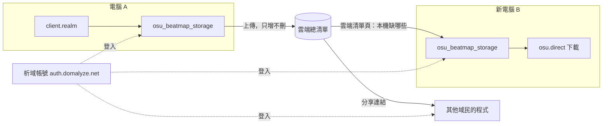

# 圖譜清單雲端同步與分享

## 背景與動機

osu_beatmap_storage 目前只讀本機 osu!lazer 的 `client.realm`。換電腦時要先匯出 CSV、自己保管檔案，再到新電腦匯入，才能找回原本有哪些圖譜。

這份規格讓使用者用析域帳號登入，把自己擁有的圖譜清單存到雲端。換電腦時登入就能看到清單並重新下載，也能把清單分享給其他域民。

## 目標與非目標

**目標**
- 域民登入後，本機圖譜清單能上傳到雲端，換電腦後找回並重新下載
- 多台電腦的圖譜合併成同一份雲端清單
- 域民可以用連結分享自己的清單，對方能瀏覽、下載，也能複製進自己的雲端清單

**非目標**
- 不同步圖譜檔案本身（`.osz`），只同步清單；下載仍走既有的 osu.direct 流程
- 不同步沒有 OnlineID 的圖譜，例如本地自製或沒上傳到官網的圖譜
- 不做網頁版瀏覽，分享的清單只在桌面程式裡看
- 後端平台本身的模組化架構、部署和接析域的方式另寫一份規格，這份只列 osu 模組對後端的需求

## 已定案的前提

- 身分一律走析域帳號（`auth.domalyze.net`，OIDC），開放給所有域民使用
- 析域 auth server 只管身分，清單資料存在新的獨立後端。後端分模組，各模組支援不同服務，osu 圖譜清單是其中一個模組
- 雲端每張圖譜的欄位與現有 CSV 相同：OnlineID、Title、TitleUnicode、Artist、ArtistUnicode、Creator、Status、難度數、模式、最低星數、最高星數、BPM、加入日期、提交日期
- 既有的 CSV 匯出和匯入功能保留

## 範圍

1. 桌面程式登入、登出析域帳號
2. 自動上傳與手動上傳本機清單
3. 雲端清單頁：檢視雲端清單、標出本機有或缺、勾選下載、手動刪除雲端紀錄
4. 舊 CSV 匯入雲端
5. 分享連結：產生、撤銷或重新產生、用連結開啟他人清單、下載、複製進自己的清單
6. 析域帳號生命週期事件（刪除、停權、合併）對雲端資料的處理
7. 上傳頻率限制

## 詳細規格

### 整體動線

### 登入與帳號

- 登入是選用功能。沒登入時，現有所有功能照常可用
- 同一台電腦換帳號登入時不做特別處理。本機圖譜會照常上傳到新帳號的清單，因為那就是新帳號現在擁有的圖譜
- 換成不同的域民後，自動上傳會自動恢復成關閉；登出後登回同一個域民，自動上傳維持原本的設定

### 上傳規則

- **自動上傳預設關閉**，使用者要自己打開。打開後，每次程式開啟並讀到 `client.realm` 時觸發一次
- **手動上傳**就是立刻同步一次，規則跟自動上傳相同
- 上傳**只增不刪**：本機沒有、但雲端有的圖譜，不會因為上傳而被刪除。要從雲端移除只能在雲端清單頁手動刪
- 雲端總清單是所有電腦上傳結果的聯集
- 沒有 OnlineID 的圖譜不上傳
- 雲端已有同一張圖譜（同一個 OnlineID）時：
  - 加入日期取所有上傳中最早的那次，代表「第一次擁有」的時間
  - 其餘欄位用最新一次上傳的值覆蓋，例如 Status 從 pending 變成 ranked
- 一次上傳大量圖譜時顯示進度，但不擋住其他功能
- 沒登入或後端連不上時同步靜默跳過，只在狀態區顯示，不彈窗

### 雲端清單頁

- 列出雲端清單，每張圖譜標示本機有或本機缺
- 可以勾選要下載的圖譜，交給既有的下載佇列
- 可以刪除雲端紀錄：單張、批量勾選、整份清空都支援
- 換新電腦的主要流程：登入 → 開雲端清單頁 → 勾選本機缺的圖譜 → 下載

### 舊 CSV 匯入雲端

- 可以把先前匯出的 CSV 匯入雲端清單
- 合併規則跟上傳相同：只增不刪、加入日期取最早、其餘欄位用最新的值

### 分享

- 每個域民目前只有**一條**分享連結，可以撤銷或重新產生；重新產生後，舊連結失效
- 拿到連結**而且**已登入析域帳號的人才能看
- 只在桌面程式裡開啟，不做網頁。連結格式是 `osu-storage://share/<token>`，點了直接開程式；也可以把連結貼進程式開啟
- 未登入時開啟連結，先提示登入，登入完成後自動開啟該連結
- 清單顯示擁有者目前的域民代號
- 內容是擁有者整份清單的**即時**狀態，擁有者之後新增或刪除的圖譜都會反映出來
- 看的人可以：
  - 瀏覽清單
  - 勾選下載，交給下載佇列
  - 一鍵把整份清單複製進自己的雲端清單，合併規則跟上傳相同
- 看的人下載圖譜後不做特別處理；如果他開了自動上傳，下次同步時這些圖譜就會進他自己的清單

### 析域帳號生命週期

| 事件 | 雲端清單 | 分享連結 |
|---|---|---|
| 域民刪除 | 刪除 | 刪除 |
| 域民停權 | 刪除 | 刪除 |
| 兩個域民合併 | 依上傳規則合併成一份 | 保留存續者的連結，被併掉那條失效 |

### 限制

- 每人清單張數不設上限
- 頻率限制依觸發來源分開計算：自動上傳每 10 分鐘一次；手動上傳、CSV 匯入雲端、複製別人的清單各自每分鐘一次
- 被頻率限制擋下時，自動上傳靜默跳過，其他顯示「請稍後再試」

## 驗收條件

驗收情境在 design-to-tickets 拆任務卡時，逐張任務卡定義。

## 考慮過但捨棄的方向

- **同步到使用者自己的雲端空間**（Google Drive、OneDrive、Gist）：不採用，改用析域帳號統一身分，分享功能也需要集中式後端
- **只靠雲端同步資料夾放 CSV、不做登入**：做不到跨使用者分享
- **鏡像同步，任一台電腦沒有就刪**：新電腦本機是空的，第一次自動上傳就會清空雲端清單；多台電腦時雲端最後只剩交集，違反「找回來」的目的
- **每台電腦各存一份快照**：使用者要的是一份總清單
- **只刪「這台電腦曾經有過」的圖譜**：可行，但規則較複雜，最後選擇更單純的只增不刪加手動刪除

## 已知限制與風險

- 只增不刪代表使用者在 osu!lazer 刪掉的圖譜會一直留在雲端，直到手動刪除。這是為了換電腦安全而接受的取捨
- 停權直接刪除資料，解除停權後清單找不回來
- 分享內容是即時的，擁有者手動刪除的圖譜會直接從對方看到的清單消失

## 待決事項

無。

## 參考資料

- 析域帳號：`auth.domalyze.net`，Ory Hydra＋自寫身分模組，OIDC 登入；身分與業務資料分離，服務只拿內部 user ID
- 現有 CSV 匯出欄位：[lib/pages/beatmap_list_page.dart](../../lib/pages/beatmap_list_page.dart)
- 後端平台規格：另寫一份（尚未建立）
- 任務卡：[docs/tickets/cloud-beatmap-sync.md](../tickets/cloud-beatmap-sync.md)
