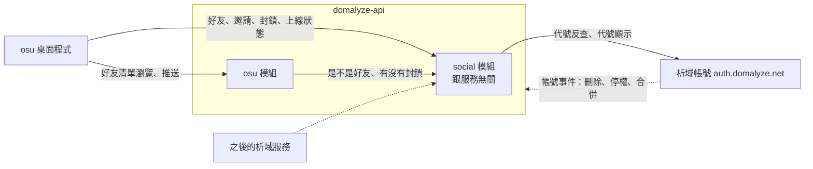

# 好友系統

## 背景與動機

目前域民之間分享圖譜清單只能靠分享連結：擁有者產生連結，自己傳給對方，對方再用連結開啟。每次要給熟人看都得額外傳一次連結，也沒辦法只挑幾張圖給特定的人。

這份規格在析域加入好友關係。好友之間不必傳連結就能直接瀏覽彼此的清單，也能挑選圖譜推送給特定好友，並看到好友是否正在玩 osu!lazer。好友關係本身做成析域共用的功能，osu_beatmap_storage 是第一個使用它的服務。

## 目標與非目標

**目標**
- 域民之間可以建立雙向好友關係，也可以封鎖別人
- 好友不需要分享連結就能直接瀏覽對方的整份雲端清單
- 可以挑選圖譜推送給一位或多位好友，對方在程式內收到並能下載或收進自己的清單
- 看得到好友是否正在玩 osu!lazer
- 好友關係、邀請、封鎖、上線狀態跟 osu 無關，之後其他析域服務可以直接沿用

**非目標**
- 這次不做其他服務的好友介面，網站和 XingyuBot 都不做；管理介面只做在 osu 桌面程式
- 不支援第三方服務：只有析域 first-party 的服務能使用好友功能
- 不顯示好友正在玩哪張圖，只顯示「遊玩中」
- 不做 Discord 私訊等程式外的通知管道
- 不限制推送頻率

## 已定案的前提

- 好友功能放在 `domalyze-api`（`api.domalyze.net`），以獨立模組的形式存在，auth server 不存放好友資料
- 跟服務無關的部分放在通用的 `social` 模組：好友關係、邀請、封鎖、上線狀態。跟 osu 有關的部分放在 `osu` 模組：好友瀏覽清單、推送圖譜。`osu` 模組只透過 `social` 模組提供的介面查詢好友關係，不直接讀它的資料
- 只接受 first-party client 的 access token：外部服務拿到的是 pairwise sub，不是 account_id，所以無法使用好友功能
- 既有的分享連結保留，與好友瀏覽並存

## 範圍

1. 好友關係：邀請、接受、拒絕、取消邀請、刪除好友
2. 三種加好友方式：輸入域民代號、從分享清單頁加、好友邀請連結
3. 封鎖與解除封鎖
4. 好友列表：搜尋、排序、顯示上線狀態
5. 好友瀏覽清單，以及清單的公開開關
6. 推送圖譜與收件匣
7. 上線狀態回報與公開開關
8. 通知：程式內紅點與列表、Windows 系統通知
9. 桌面程式的系統匣常駐與開機自動啟動
10. 析域帳號生命週期事件對好友資料的處理
11. auth server 新增「域民代號 → account_id」的反查內部 API（跨 repo 依賴）

## 詳細規格

### 好友關係

- 好友是**雙向**的：A 送出邀請，B 接受後兩人才成為好友
- A 邀請 B 的時候，如果 B 已經邀請過 A，兩人直接成為好友
- 尚未回應的邀請不會過期；送出的人可以取消，收到的人可以拒絕
- 每人好友上限 500 人
- 任何一方都可以刪除好友。刪除後，雙方先前收到的推送照樣保留

### 加好友的方式

| 方式 | 流程 | 是否需要對方接受 |
|---|---|---|
| 輸入域民代號 | 輸入代號後先顯示對方的代號（有頭像時一併顯示），確認後送出邀請 | 需要 |
| 從分享清單頁加 | 用分享連結開啟別人的清單時，頁面上有「加好友」按鈕 | 需要 |
| 好友邀請連結 | A 產生邀請連結傳給 B，B 開啟後兩人直接成為好友 | 不需要，A 產生連結時就等於同意 |

- 好友邀請連結是一次性的：用過一次就失效。可以產生多條分給不同人，還沒用過的可以撤銷
- 每人 24 小時內最多送出 50 筆好友邀請；用邀請連結加好友、互送自動成立不算在內
- 域民代號可以修改，而且改掉的舊代號會被釋出，所以用代號查到的一律是對方「現在」的代號。送出前的確認畫面就是為了避免加錯人

### 封鎖

- 封鎖某人時，如果兩人是好友，關係會直接解除
- 被封鎖的人不能再向封鎖者送出邀請，也不能使用封鎖者的好友邀請連結。對方不會被告知自己遭到封鎖
- 封鎖**不影響**分享連結：被封鎖的人拿到分享連結仍然看得到清單
- 封鎖**不會**清掉先前收到的推送
- 封鎖者可以解除封鎖；解除後不會自動恢復好友關係

### 好友列表

- 一律顯示好友目前的域民代號
- 可以用代號搜尋
- 排序：遊玩中的好友排在前面，其餘依代號排序
- 列表上顯示每位好友是否正在遊玩，對方關掉上線狀態時就不顯示
- 好友有開放清單時，列表上提供瀏覽清單的入口；對方關掉時，不顯示這個入口

### 好友瀏覽清單

- 所有好友預設都能瀏覽我的整份雲端清單。我可以用一個總開關關掉，關掉後所有好友都看不到
- 好友看到的內容和操作跟分享連結完全相同：整份清單的即時狀態，可以瀏覽、勾選下載，也能複製進自己的雲端清單
- 分享連結的開關和好友瀏覽的開關互相獨立

### 推送圖譜

- 在自己的雲端清單或本機的圖譜查看頁勾選圖譜，推送給一位或多位好友；本機有、還沒上傳的圖也能推
- 一次最多推送 100 張，可以附一段最多 200 字的附言
- 只能推送給好友；被封鎖的人已經不是好友，自然也無法推送
- 收到的推送進入收件匣，可以：
  - 下載，交給既有的下載佇列
  - 收進自己的雲端清單，合併規則跟上傳相同
  - 標為已讀
  - 刪除
- 推送會一直保留，直到收件人自己刪除

### 上線狀態

- 桌面程式偵測 osu!lazer 是否在執行。正在執行時，好友看到「遊玩中」，其他情況都不顯示狀態
- 只有桌面程式開著並已登入時才會回報；程式結束或一段時間沒有回報就算離線
- 使用者可以在設定裡關掉上線狀態，預設開啟。關掉後好友看不到我的遊玩狀態

### 通知

- 收到推送或好友邀請時：
  - 程式內顯示紅點，並列在對應的列表中
  - 程式開著時（包括縮在系統匣），另外發一則 Windows 系統通知
- 邀請、推送與好友的上線狀態都即時送達，幾秒內反映，不靠定時查詢
- 程式沒開的期間收到的內容，下次開啟時只顯示紅點，不補發 Windows 通知

### 系統匣與開機自動啟動

- 第一次關閉視窗時，詢問要縮到系統匣還是結束程式，並可以勾選記住這個選擇。記住後下次不再詢問，之後可以在設定裡更改
- 系統匣的右鍵選單目前只有「結束」
- 開機自動啟動預設關閉，可以在設定裡打開；開機啟動時直接縮在系統匣，不開視窗

### 析域帳號生命週期

| 事件 | 好友關係與邀請 | 封鎖 | 推送 |
|---|---|---|---|
| 域民刪除 | 全部刪除 | 全部刪除 | 全部刪除，包括他送出的與收到的 |
| 域民停權 | 保留，但對好友隱藏：不出現在好友列表，也不能收推送 | 保留 | 保留 |
| 解除停權 | 恢復顯示 | 不變 | 不變 |
| 兩個域民合併 | 併入存續者並去重；兩人之間原有的關係丟掉 | 併入存續者並去重；兩人之間的封鎖丟掉 | 併入存續者；兩人之間互相推送的內容丟掉 |

## 驗收條件

驗收情境在 design-to-tickets 拆任務卡時，逐張任務卡定義。

## 考慮過但捨棄的方向

- **好友資料放在 auth server**：auth server 是獨立的 IdP，好友功能變動頻繁、端點多，放進去會擴大 IdP 的攻擊面和故障影響範圍
- **另外部署獨立的 social service**：目前只有一個服務使用，多一個服務的部署和服務間呼叫成本不划算；只要模組邊界守住，日後要拆出去也容易
- **單向追蹤**：使用者要的是雙方都同意的好友關係
- **好友邀請連結只送出邀請**：產生連結的人本來就同意了，再按一次接受是多餘的
- **只保留好友瀏覽、拿掉分享連結**：分享連結仍然需要用來分享給非好友
- **顯示好友正在玩哪張圖**：osu!lazer 沒有官方 API，只能靠讀記憶體的工具，lazer 改版時容易失效
- **逐位好友設定能不能看清單**：先用一個總開關就夠
- **Discord 私訊通知**：需要跟 XingyuBot 跨專案合作，這次不做

## 已知限制與風險

- 上線狀態只有在對方開著桌面程式時才準確。沒開程式時玩 lazer，好友會看到離線
- 上線狀態只有全有或全無的開關，沒辦法只對部分好友公開，先接受
- 封鎖不影響分享連結：要阻止特定的人看清單，得重新產生分享連結
- 推送不設頻率限制。只有好友能推送，加上封鎖機制，先不處理濫用問題
- 一次性邀請連結被別人搶先使用時，原本要給的人只會看到連結失效，要重新產生
- 用代號加好友依賴 auth server 新增反查 API，那邊完成之前這個方式不能用

## 待決事項

無。

## 參考資料

- 雲端同步與分享規格：[cloud-beatmap-sync.md](cloud-beatmap-sync.md)
- 後端：`d:/github/domalyze-api`；模組登記方式見該 repo 的 README〈新增模組〉，token 驗證規則見 `src/domalyze_api/auth.py`
- 代號查詢：`domalyze-api` 的 `src/domalyze_api/identity.py` 目前只支援用 account_id 查代號
