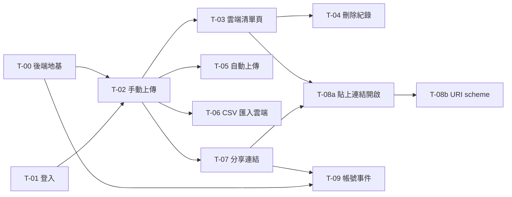

# 圖譜清單雲端同步與分享 任務拆解

規格：[docs/specs/cloud-beatmap-sync.md](../specs/cloud-beatmap-sync.md)

後端的實作設計與 API 契約在 domalyze-api repo 的 [後端任務](https://github.com/willy1236/domalyze-api/blob/main/docs/tickets/osu-cloud-beatmap-sync.md)，這份的卡片只寫桌面程式與身分設定，後端部分以卡號對照。

## 現況與前提

- 技術棧
  - 桌面程式：Flutter（Windows），狀態用 `StatefulWidget` 加單例 `ChangeNotifier`（例如 `DownloadService.instance`），設定存在執行目錄的 `config.json`（`PrefsService`）
  - 後端：新 repo `domalyze-api`，FastAPI＋PostgreSQL，網域 `api.domalyze.net`，部署在 shark（docker compose＋traefik）。osu 圖譜清單是其中一個模組，路徑前綴 `/osu`
  - 身分：析域帳號 `auth.domalyze.net`（自寫身分模組＋Ory Hydra），client 清單在 domalyze-identity 的 `identity-clients.toml`
- 既有相關機制
  - `BeatmapListPage._loadRealm()` 讀 `client.realm`，過濾掉 `deletePending` 的圖譜後存成 `_beatmapSets`，是自動上傳的觸發點與本機清單來源
  - `BeatmapListPage._exportCsv()` 從 `BeatmapSetInfo` 算出 CSV 的 14 個欄位，雲端欄位與它相同
  - `BeatmapListPage._importCsv()` → `CsvImportPage` 顯示 CSV 清單、批量下載，`CsvRowTile` 顯示單列
  - `DownloadService.instance.enqueue(onlineID, title)`／`enqueueAll(...)` 是下載佇列入口
  - 析域：first-party client 拿到的 `sub` 是 account_id，跳過同意頁；`token_endpoint_auth_method = "none"` 的 public client 不需要 secret；帳號事件（SET）可訂閱 `account-disabled`、`account-purged`、`account-merged`，合併事件帶存續者的 `sub`
- 這次會動到的既有部位
  - `lib/pages/beatmap_list_page.dart`（AppBar 按鈕、`_loadRealm`、`_exportCsv`、`_importCsv`）
  - `lib/pages/csv_import_page.dart`、`lib/services/prefs_service.dart`、`lib/app.dart` 或 `lib/pages/home_page.dart`（帳號入口）
  - `pubspec.yaml`（新增 OIDC、HTTP、安全儲存套件）
  - domalyze-identity 的 `identity-clients.toml`（新增桌面 client 與後端的事件訂閱）
- 已定案的技術前提
  - 析域只管身分，清單存在 `domalyze-api` 的 osu 模組
  - 後端平台只做 osu 模組用得到的最小地基（T-00）；其餘平台設計等「後端平台規格」寫好再補，屆時回頭核對 T-00 的介面
  - 雲端欄位與 CSV 相同；沒有 OnlineID 的圖譜不上傳
  - 上傳只增不刪；合併規則：加入日期取最早，其餘欄位用最新上傳的值
  - 頻率限制依觸發來源分開計算：自動上傳每 10 分鐘一次；手動上傳、CSV 匯入雲端、複製別人的清單各自每分鐘一次。被擋時，自動上傳靜默跳過，其他顯示「請稍後再試」
  - 分享連結是自訂 URI scheme `osu-storage://share/<token>`，點了直接開程式；也可以把連結貼進程式開啟

## 實作順序總覽

| # | 卡號 | 標題 | 依賴 | 並行組 | 備註 |
|---|---|---|---|---|---|
| 1 | T-00 | [地基] domalyze-api：上線並能驗析域 token、掛載模組 | 無 | 0 | 新 repo；T-02、T-09 依賴 |
| 2 | T-01 | 域民能在程式裡登入、登出析域帳號 | 無 | 0 | 只動桌面程式與 identity 設定，與 T-00 不同 repo，可並行 |
| 3 | T-02 | 域民能手動把本機清單上傳到雲端 | T-00、T-01 | — | 骨架切片：第一次端到端跑通 |
| 4 | T-03 | 域民能在雲端清單頁看到本機缺哪些圖譜並下載 | T-02 | A | |
| 5 | T-05 | 域民能開啟自動上傳 | T-02 | A | |
| 6 | T-06 | 域民能把舊 CSV 匯入雲端 | T-02 | A | |
| 7 | T-07 | 域民能產生、撤銷、重新產生分享連結 | T-02 | A | |
| 8 | T-04 | 域民能從雲端清單刪除紀錄 | T-03 | B | |
| 9 | T-08a | 域民能用分享連結瀏覽、下載、複製別人的清單（貼上連結開啟） | T-03、T-07 | B | 從 T-08 拆出 |
| 10 | T-08b | 點 `osu-storage://` 連結開啟程式（URI scheme 註冊與單一執行個體） | T-08a | B | 從 T-08 拆出 |
| 11 | T-09 | 域民刪除、停權、合併時雲端資料跟著處理 | T-00、T-07 | B | 純後端，含平台的 SET 接收 |

並行組 A 都會在 `BeatmapListPage` 的 AppBar 或帳號選單加入口，屬於同檔不同段落，git 可自動合併，不另抽共用卡。

## 任務卡

### T-00 [地基] domalyze-api：上線並能驗析域 token、掛載模組

後端地基卡，全文見 [後端任務](https://github.com/willy1236/domalyze-api/blob/main/docs/tickets/osu-cloud-beatmap-sync.md) 的 T-00。進度也記在那份。

### T-01 域民能在程式裡登入、登出析域帳號

**使用者價值**：域民能用析域帳號登入桌面程式，之後的雲端同步與分享都以此為身分。沒登入時現有功能完全不受影響。

**範圍**
- 包含：註冊桌面 client、登入、登出、重開程式後維持登入、顯示目前登入的域民代號
- 不包含：任何雲端資料操作（T-02 起）

**驗收條件**
- [ ] 沒登入時，圖譜查看、CSV、下載、回放匯出照常可用
- [x] 點「登入」會開系統瀏覽器到析域登入頁；登入完成後回到程式，顯示目前的域民代號
- [x] 關掉程式再開，仍是登入狀態，不必重新登入
- [x] 點「登出」後回到未登入狀態；再登入可以選另一個域民
- [x] 在瀏覽器取消登入或關掉分頁時，程式回到未登入狀態，不卡住
- [x] refresh token 失效時（例如域民被停權），程式回到未登入狀態，狀態區顯示需要重新登入，不彈窗

**實作設計**
- 資料
  - 桌面：access token、refresh token 存 Windows Credential Manager（例如 `flutter_secure_storage`），不寫進 `config.json`
  - 桌面：`config.json` 只記目前登入的 `sub` 與域民代號，供 T-05 判斷是否換帳號
- 後端：無
- 身分設定：domalyze-identity 的 `identity-clients.toml` 新增 client
  - `client_id = "osu-beatmap-storage"`、`first_party = true`、`token_endpoint_auth_method = "none"`
  - `redirect_uris = ["http://127.0.0.1/callback"]`，依 RFC 8252 loopback 規則，程式執行時用隨機 port
  - scope：`openid offline_access profile`
- 前端
  - 新增 `AuthService`（單例 `ChangeNotifier`，比照 `DownloadService`）：authorization code＋PKCE、開系統瀏覽器、本機 `HttpServer` 收 callback、token 換發與 refresh、登出
  - `NavigationRail` 底部（`home_page.dart`）新增帳號入口：未登入顯示「登入」，已登入顯示域民代號與「登出」
- 介面：`AuthService.instance` 提供 `isLoggedIn`、`sub`、`username`、`Future<String?> accessToken()`（自動 refresh，失敗時轉成未登入並回 null）、`login()`、`logout()`；T-02 之後的雲端呼叫都從這裡拿 token

**依賴**：無（不需要後端，但 identity 設定要先部署）

**風險 / 實作注意**
- Hydra 對 loopback redirect 忽略 port 的行為要實測；不行的話改成固定 port 範圍
- 登出要不要同時呼叫 Hydra 的 end session，由實作者決定

**進度**：實作完成（2026-10-23）
- commit：`89acea2`、`447f4bc`、`bf8bd79`、`ee77dcd`
- 未驗（待手動驗證）：沒登入時圖譜查看、CSV、下載、回放匯出照常可用；登出後再登入實際選另一個域民；refresh token 失效時狀態區顯示「需要重新登入」的文字
- 實作決定
  - 登出只做本機登出並 revoke refresh token，不呼叫 end session；登出後下次登入帶 `prompt=login`，所以 domalyze-identity 的 `/login` 改為支援 `prompt=login`（A2，已由使用者部署，超出原卡「只改設定」的範圍）
  - Hydra 對 loopback redirect 忽略 port，已依 fosite 原始碼確認，不需固定 port 範圍
  - `flutter_secure_storage` 實際是 AES-GCM 加密檔，金鑰存在 Credential Manager
  - 建置需要 Visual Studio 的 C++ ATL
  - 使用者已實測：點登入開啟瀏覽器、登入後顯示域民代號

### T-02 域民能手動把本機清單上傳到雲端

**使用者價值**：第一次端到端跑通「本機清單 → 雲端」，域民能手動備份自己有哪些圖譜。同時建立後續各卡共用的合併規則與上傳流程。

**範圍**
- 包含：桌面的手動上傳按鈕與進度顯示、把 `_exportCsv` 的欄位計算抽成共用的對應函式；後端的合併端點與頻率限制見後端任務 T-02
- 不包含：檢視雲端清單（T-03）、自動上傳（T-05）

**驗收條件**
- [ ] 已登入時，圖譜查看頁有「上傳到雲端」按鈕；未登入時按鈕不出現或停用
- [ ] 上傳時顯示進度，期間可以繼續瀏覽、搜尋、下載
- [x] 沒有 OnlineID 的圖譜不會出現在雲端
- [ ] 同一張圖譜第二次上傳時，Status 等欄位更新為最新值，加入日期保留較早的那次
- [ ] 本機已刪除、但雲端有的圖譜，上傳後雲端仍保留
- [ ] 後端連不上時，狀態區顯示上傳失敗，不彈窗，其他功能照常
- [ ] 1 分鐘內第二次手動上傳時顯示「請稍後再試」，雲端資料不變
- [x] CSV 匯出的內容與改版前相同

**實作設計**
- 後端：見 [後端任務](https://github.com/willy1236/domalyze-api/blob/main/docs/tickets/osu-cloud-beatmap-sync.md) 的 T-02，合併寫入端點與頻率限制
- 前端
  - 抽出 `toCloudEntry(BeatmapSetInfo)`（新檔，例如 `lib/models/cloud_entry.dart`），`_exportCsv` 改用它算欄位，T-06 也用同一個資料形狀
  - 新增 `CloudSyncService`（單例 `ChangeNotifier`）：`upload(entries, trigger)` 分批呼叫 merge，提供進度（已送／總數）與最後一次結果
  - AppBar 新增上傳按鈕；進度用 AppBar 下方的細進度條，不擋住操作
- 介面
  - `CloudEntry`：對應後端契約的 BeatmapEntry，含 `toJson`／`fromJson`；T-03、T-06、T-08 共用
  - `CloudSyncService.instance.upload(List<CloudEntry>, {required String trigger})`；收到 429 時結果標為「被頻率限制擋下」，由呼叫端決定顯示或靜默；同一次上傳的分批共用一個 `sync_id`，後端只在第一批之後 10 分鐘內免檢查頻率；收到 503 `unavailable`（登入服務暫時連不上）時當成暫時失敗，不登出
  - `progress`、`lastError` 讓 UI 監聽

**依賴**：T-01（取 token）、後端 T-02（合併端點上線，後端 T-00 已完成）

**風險 / 實作注意**
- 雲端存的是結構化值（status 代碼、modes 陣列、星數與 BPM 的最小最大值），`CloudEntry` 要能格式化成與 CSV 匯出相同的顯示

**進度**：實作完成（2026-10-23）
- commit：`2bbda7e`、`64ff909`、`160f4ab`、`dd9bce9`、`3127a5a`
- 未驗（待手動驗證，部分需連真實後端）：已登入才有上傳按鈕；上傳進度顯示且期間可繼續操作；第二次上傳更新欄位並保留較早加入日期；本機已刪除的圖譜雲端仍保留；後端連不上時狀態區顯示失敗；1 分鐘內第二次手動上傳顯示「請稍後再試」
- 實作決定
  - CSV 欄位繼續從 `BeatmapSetInfo` 以 `csvFieldsOf` 計算，`toCloudEntry` 另外計算 min／max，以保證 CSV 輸出逐字相同（偏離原卡「`_exportCsv` 改用 `toCloudEntry`」）
  - ruleset 為 null 的難度不放進雲端 `modes`
  - 上傳失敗後 10 分鐘內同 trigger 重試沿用同一個 `sync_id`
  - 後端回 401 時，經共用 `ApiClient` 自動 refresh 並重試一次，仍 401 就轉為需要重新登入

### T-03 域民能在雲端清單頁看到本機缺哪些圖譜並下載

**使用者價值**：換新電腦時，域民登入後能看到雲端清單、找出本機缺的圖譜，勾選後重新下載。這是整個功能「找回來」的主要出口。

**範圍**
- 包含：雲端清單頁、本機有／缺標示、搜尋、勾選下載
- 不包含：刪除雲端紀錄（T-04）

**驗收條件**
- [ ] 已登入時能從帳號選單或 AppBar 進入雲端清單頁；未登入時入口不出現
- [x] 每張圖譜標示「本機有」或「本機缺」，並可以只看本機缺的
- [x] 可以用標題、藝術家、製圖者搜尋，規則與 `CsvImportPage` 相同
- [ ] 勾選多張或「全選本機缺的」後按下載，這些圖譜進入下載佇列
- [x] 新電腦本機 0 張時，所有圖譜都標為本機缺
- [x] 後端連不上時，頁面顯示錯誤與重試按鈕

**實作設計**
- 後端：見 [後端任務](https://github.com/willy1236/domalyze-api/blob/main/docs/tickets/osu-cloud-beatmap-sync.md) 的 T-03
- 前端
  - 新頁面 `CloudListPage`：列表項目沿用 `CsvRowTile` 的版面，加上勾選框與本機有／缺標籤
  - 本機 OnlineID 集合由 `BeatmapListPage` 傳入（取自 `_beatmapSets`）；`client.realm` 沒載入時全部視為本機缺
  - 下載用 `DownloadService.instance.enqueueAll`
- 介面：`CloudListPage` 的參數是「清單來源」與「是否可刪除」，T-08 用同一頁面顯示別人的清單

**依賴**：T-02（`CloudEntry` 與雲端資料）、後端 T-03

**進度**：實作完成（2026-10-23）
- commit：`ed1b66d`、`1dcf3d2`
- 未驗（待手動驗證）：已登入才有雲端清單入口；勾選或全選本機缺的後按下載會進入下載佇列
- 實作決定：入口放在圖譜查看頁 AppBar；`canDelete` 留給 T-04

### T-04 域民能從雲端清單刪除紀錄

**使用者價值**：自動上傳只增不刪，域民靠這張卡清掉不要的紀錄。

**範圍**
- 包含：單張刪除、勾選批量刪除、整份清空
- 不包含：別人的分享清單上沒有刪除（T-08 以唯讀模式開啟）

**驗收條件**
- [x] 在雲端清單頁可以刪除單張圖譜，刪除後列表立即更新
- [x] 勾選多張後可以一次刪除
- [x] 「清空雲端清單」要二次確認，確認後清單為空
- [x] 刪除的圖譜如果本機還有，下次上傳時會再出現（只增不刪的預期行為），確認對話框要提示這點
- [ ] 刪除後，分享連結看到的清單也同步少了這些圖譜

**實作設計**
- 後端：見 [後端任務](https://github.com/willy1236/domalyze-api/blob/main/docs/tickets/osu-cloud-beatmap-sync.md) 的 T-04
- 前端：`CloudListPage` 在可刪除模式下顯示刪除動作；批量刪除與勾選下載共用同一組勾選狀態

**依賴**：T-03、後端 T-04

**進度**：實作完成（2026-10-23）
- commit：`66835fb`、`8d7aa76`
- 未驗（待手動驗證）：刪除後分享連結看到的清單同步變少（端到端，需真實後端）
- 實作決定
  - 清空為兩層確認
  - 單張刪除的做法是勾選一張後按 AppBar 的刪除，與批量共用同一組勾選狀態
  - 刪除成功只在本地移除，不重新讀取

### T-05 域民能開啟自動上傳

**使用者價值**：域民打開後，每次開程式就自動備份，不用記得手動上傳。

**範圍**
- 包含：自動上傳開關、程式開啟讀到 `client.realm` 時觸發、換帳號自動關閉
- 不包含：其他觸發時機，例如下載完成或定時

**驗收條件**
- [x] 第一次登入時自動上傳是關閉的
- [ ] 打開後，下次開程式讀到 `client.realm` 時自動上傳，進度顯示方式與手動上傳相同
- [x] 登出後改登另一個域民，自動上傳變回關閉；登出後登回同一個域民，自動上傳維持開啟
- [ ] 沒登入或後端連不上時靜默跳過，只在狀態區顯示，不彈窗
- [x] 同一個域民 10 分鐘內第二次自動上傳被後端拒絕，程式靜默跳過；手動上傳另外計算，不受這個限制影響
- [ ] 重新選 `client.realm` 路徑或按重新載入時不觸發自動上傳，只在程式開啟時觸發一次

**實作設計**
- 資料
  - 桌面：`config.json` 新增 `auto_upload_sub`。值等於目前登入的 `sub` 時代表開啟，所以預設與換帳號後都是關閉；登出時保留，登回同一個域民就恢復開啟
- 後端：沿用後端 T-02 的合併端點，`trigger = "auto"`
- 前端
  - 帳號選單新增「自動上傳」開關
  - `BeatmapListPage` 記一個「這次執行已自動上傳過」旗標，第一次 `_loadRealm` 成功後呼叫 `CloudSyncService.upload(..., trigger: "auto")`
  - 收到 429 當成成功跳過

**依賴**：T-02

**進度**：實作完成（2026-10-23）
- commit：`c60aa0d`、`14f2e04`、`31f4070`
- 未驗（待手動驗證）：打開後下次開程式實際自動上傳且進度顯示同手動上傳；後端連不上時靜默跳過；重新選 `client.realm` 路徑或重新載入不觸發自動上傳
- 實作決定
  - 邏輯放在 `AutoUploadService`，`AuthService` 新增 `ready` 供等待登入還原
  - 開關放在帳號彈出選單

### T-06 域民能把舊 CSV 匯入雲端

**使用者價值**：在這個功能出現前用 CSV 備份的域民，能把舊清單併進雲端，不必先下載回本機。

**範圍**
- 包含：在 CSV 匯入頁加「匯入雲端」動作
- 不包含：CSV 匯出與匯入本身的行為不變

**驗收條件**
- [ ] 已登入時，CSV 匯入頁有「匯入雲端」按鈕；未登入時不出現
- [ ] 匯入後，CSV 裡有 OnlineID 的圖譜都出現在雲端清單，合併規則與上傳相同
- [ ] CSV 的 OnlineID 空白、為 0 或格式錯誤的列略過，完成時顯示略過幾筆
- [ ] 匯入時顯示進度，不擋其他功能
- [ ] 1 分鐘內第二次匯入時顯示「請稍後再試」

**實作設計**
- 前端
  - `CsvImportPage` 新增按鈕，依目前的篩選結果，把 `CsvRow` 轉成 `CloudEntry`
  - 欄位名稱對應 `_exportCsv` 的表頭
  - 呼叫 `CloudSyncService.upload(..., trigger: "csv")`
- 後端：沿用後端 T-02 的合併端點

**依賴**：T-02

**風險 / 實作注意**
- 舊版 CSV 可能缺欄位，缺的欄位留空，不擋匯入
- CSV 的 Status 是標籤文字、模式是 `osu/taiko`、BPM 是 `120-180`、日期只有年月日，要反解析成後端契約的型別；日期以當地 00:00 送出

**進度**：實作完成（2026-10-23）
- commit：`ebf34b8`、`6d4f75a`
- 未驗（待手動驗證）：已登入才有「匯入雲端」按鈕；匯入後在雲端清單看到且合併規則正確（端到端）；完成時顯示略過筆數；匯入進度顯示；1 分鐘內第二次匯入顯示「請稍後再試」
- 實作決定
  - CSV 缺加入日期的列，用匯入當下的時間
  - 匯入前有確認對話框

### T-07 域民能產生、撤銷、重新產生分享連結

**使用者價值**：域民能把自己的清單分享給其他域民，也能隨時收回。

**範圍**
- 包含：查看目前連結、產生、重新產生、撤銷、複製到剪貼簿
- 不包含：開啟別人的連結（T-08）

**驗收條件**
- [x] 沒有連結時可以產生一條；已有連結時顯示它並可以複製
- [x] 重新產生後舊連結失效，用舊連結開啟時顯示「連結已失效」
- [x] 撤銷後沒有任何有效連結
- [x] 每個域民同時只有一條有效連結

**實作設計**
- 後端：見 [後端任務](https://github.com/willy1236/domalyze-api/blob/main/docs/tickets/osu-cloud-beatmap-sync.md) 的 T-07
- 前端：帳號選單新增「分享我的清單」對話框，顯示 `osu-storage://share/<token>` 並可複製
- 介面：連結格式 `osu-storage://share/<token>`，T-08 解析用

**依賴**：T-02、後端 T-07

**進度**：實作完成（2026-10-23）
- commit：`791c7fc`、`d78611a`
- 未驗（待手動驗證）：選單與對話框的實際外觀；複製後貼到別處；長代號在 NavigationRail 內被截斷
- 實作決定
  - 帳號區改成點擊彈出的選單（使用者決定），骨架由 T-07 建立；T-05、T-08 只需在 `_items` 加項目
  - 重新產生與撤銷都需二次確認
  - 不顯示 `created_at`

### T-08 域民能用分享連結瀏覽、下載、複製別人的清單（已拆成 T-08a、T-08b）

**使用者價值**：拿到連結的域民能看別人的圖譜清單、挑著下載，或整份複製進自己的雲端清單。

**範圍**
- 包含：註冊 `osu-storage://` URI scheme、點連結開啟程式、貼上連結開啟、唯讀瀏覽（含本機有／缺與擁有者代號）、勾選下載、一鍵複製進自己的清單
- 不包含：在別人的清單上刪除

**驗收條件**
T-08a（貼上連結開啟、瀏覽、下載、複製）
- [x] 在程式裡貼上同一條連結也能開啟
- [x] 清單顯示擁有者目前的域民代號，內容是對方目前的最新狀態
- [x] 未登入時開啟連結，提示需要登入並附登入按鈕；登入完成後自動開啟該連結
- [x] 連結無效、已撤銷或已重新產生時，顯示「連結已失效」
- [ ] 可以勾選下載，本機有／缺的標示與雲端清單頁相同
- [x] 「複製到我的雲端清單」完成後，這些圖譜出現在自己的清單，合併規則與上傳相同，顯示新增與更新的筆數；1 分鐘內第二次複製顯示「請稍後再試」

T-08b（URI scheme 註冊與單一執行個體）
- [ ] 程式沒開時點 `osu-storage://share/<token>`，程式啟動並開啟對方清單；程式已開著時，在既有視窗開啟，不會多開一個

**實作設計**
- 後端：見 [後端任務](https://github.com/willy1236/domalyze-api/blob/main/docs/tickets/osu-cloud-beatmap-sync.md) 的 T-08
- 前端
  - URI scheme：程式啟動時在 `HKCU\Software\Classes\osu-storage` 註冊目前執行檔的路徑，因為目前沒有安裝程式，搬移資料夾後下次啟動會自動更新
  - 單一執行個體：`windows/runner/main.cpp` 偵測已有執行個體時，把啟動參數轉交給它再結束；Dart 端用 method channel 接收連結
  - 帳號選單新增「開啟分享連結」輸入框，接受同一個格式
  - 未登入時把待開啟的 token 暫存在記憶體，`AuthService` 登入成功後開啟
  - 用 T-03 的 `CloudListPage`，以唯讀模式顯示擁有者代號，加「複製到我的雲端清單」按鈕
- 邊界：新增 Windows runner 到 Dart 的 method channel，用來轉交啟動參數

**依賴**：T-03（清單頁）、T-07（分享連結）、後端 T-08

**風險 / 實作注意**
- Discord 等聊天軟體不一定把自訂 scheme 顯示成可點的連結，所以保留貼上開啟
- 驗收條件已接近上限；若單一執行個體轉交比預期複雜，可以把 URI scheme 拆成獨立一張卡

**進度**：T-08a 實作完成、T-08b 實作完成（2026-10-23）
- commit：T-08a `67f3e62`、`d863e90`、`0e0cea9`、`5c34668`、`2338300`；T-08b `a345bec`、`58f5aca`、`ae4e32f`
- 未驗（待手動驗證）：
  - T-08a：勾選下載進入下載佇列；實際複製到自己的雲端清單（會寫入雲端，建議用測試帳號）
  - T-08b：程式沒開時點連結啟動並開啟清單；程式已開著時在既有視窗開啟、不多開；`reg query "HKCU\Software\Classes\osu-storage\shell\open\command" /ve` 的值引號正確；搬移資料夾後下次啟動自動更新路徑
- 還原登錄檔：`reg delete "HKCU\Software\Classes\osu-storage" /f`
- 實作決定
  - 使用者決定把 T-08 拆成 T-08a（貼上連結開啟、瀏覽、下載、複製，複製前有確認）與 T-08b（URI scheme 註冊與單一執行個體）
  - T-08a：新增 `LocalLibraryService`、`SharedListService`、`ShareLinkOpener`（單一入口 `open(token)`）；`CloudListPage` 新增 `extraActionsBuilder` 與 `canRetry`，標題用擁有者代號；帳號選單新增「開啟分享連結」
  - T-08b：使用 `app_links ^7.2.2`，`main.cpp` 加 `SendAppLinkToInstance`；用 `reg` 指令註冊，debug 與 release 一律註冊，啟動時先 `reg query` 比對相同就不寫；接受無連結的第二次啟動只聚焦既有視窗

### T-09 域民刪除、停權、合併時雲端資料跟著處理

純後端卡，全文見 [後端任務](https://github.com/willy1236/domalyze-api/blob/main/docs/tickets/osu-cloud-beatmap-sync.md) 的 T-09。進度也記在那份。

## 開工前待決

無。後端平台規格定案後，回頭核對 T-00 與 T-09 的平台介面。
