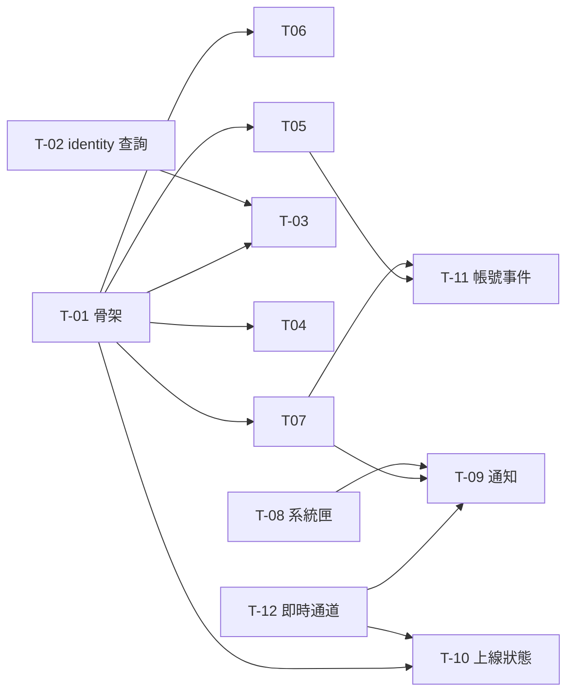

# 好友系統 任務拆解

規格：[docs/specs/friends.md](../specs/friends.md)

後端的實作設計與 API 契約在 domalyze-api repo 的 [後端任務](https://github.com/willy1236/domalyze-api/blob/main/docs/tickets/social-friends.md)，這份的卡片只寫桌面程式，後端部分以卡號對照。純後端的卡（T-02、T-11）只列在總覽。

## 現況與前提

- 技術棧
  - 桌面程式：Flutter（Windows），狀態用 `StatefulWidget` 加單例 `ChangeNotifier`，設定存在執行目錄的 `config.json`（`PrefsService`），呼叫後端一律經 `ApiClient`（自動帶 token、401 時 refresh 重試一次）
  - 後端：`domalyze-api` 的 `social` 模組（好友、邀請、封鎖、上線狀態、即時事件）與 `osu` 模組（好友瀏覽清單、推送）
- 既有相關機制
  - `HomePage` 用 `NavigationRail`（圖譜查看、回放匯出）＋`IndexedStack`；側欄底部是 `UpdateButton` 與帳號選單 `_AccountTile`
  - `CloudListPage` 是可重用的清單頁（`loader`、`localIds`、`canDelete`、`extraActionsBuilder`），已有勾選與下載；`ShareLinkOpener.open(token)` 用它開啟唯讀的別人清單，`SharedCopyButton` 負責複製
  - `CloudPresenceService` 是「登入後自動讀取、登出或換帳號時清空」的單例寫法範例
  - `AppLinkService` 接收 `osu-storage://` 連結並分派；`windows/runner/main.cpp` 用 app_links 的 `SendAppLinkToInstance()` 把連結轉給已開啟的執行個體
  - `BeatmapListPage` 沒有勾選模式；`_exportCsv` 從 `BeatmapSetInfo` 算出雲端欄位
  - 目前沒有系統匣、沒有 Windows 通知、沒有設定頁
- 這次會動到的既有部位
  - `lib/pages/home_page.dart`、`lib/pages/beatmap_list_page.dart`、`lib/pages/cloud_list_page.dart`
  - `lib/services/share_link_opener.dart`、`lib/services/app_link_service.dart`、`lib/services/prefs_service.dart`、`lib/widgets/open_share_link_dialog.dart`
  - `lib/main.dart`、`windows/runner/main.cpp`、`pubspec.yaml`
- 已定案的技術前提
  - 好友資料都在 `domalyze-api`，auth server 不存好友資料
  - 邀請、推送、上線狀態由後端用 SSE 即時送達，不定時查詢
  - 分享連結保留，與好友瀏覽並存
  - 好友邀請連結是自訂 URI scheme `osu-storage://friend/<token>`，跟分享連結共用 scheme

## 實作順序總覽

| # | 卡號 | 標題 | 依賴 | 並行組 | 備註 |
|---|---|---|---|---|---|
| 1 | T-01 | 域民能從分享清單頁送好友邀請，對方接受後雙方出現在好友列表 | 無 | 0 | 骨架切片：第一次端到端跑通；後端同卡號 |
| 2 | T-02 | [共用] 用代號查域民、批次查域民 | 無 | 0 | 純後端（含 domalyze-identity），T-03 依賴 |
| 3 | T-08 | 程式能縮到系統匣、開機自動啟動 | 無 | 0 | 純桌面，跟好友無關 |
| 4 | T-12 | [共用] 即時事件通道（SSE） | 無 | 0 | 桌面＋後端；T-09、T-10 依賴 |
| 5 | T-06 | 域民能瀏覽好友的雲端清單，也能關掉自己的公開 | T-01 | A | |
| 6 | T-07 | 域民能推送圖譜給好友，收到的人在收件匣處理 | T-01 | A | |
| 7 | T-03 | 域民能輸入代號送出好友邀請 | T-01、T-02 | A | |
| 8 | T-04 | 域民能用一次性好友邀請連結直接加好友 | T-01 | A | |
| 9 | T-05 | 域民能刪除好友、封鎖與解除封鎖 | T-01 | A | |
| 10 | T-10 | 好友看得到我正在玩 osu!lazer，好友列表能搜尋、排序 | T-01、T-12 | A | |
| 11 | T-09 | 收到好友邀請或推送時，看到紅點與 Windows 通知 | T-07、T-08、T-12 | B | |
| 12 | T-11 | 域民刪除、停權、合併時，好友資料跟著處理 | T-05、T-07 | B | 純後端＋identity 設定 |

並行組 A 的卡都會在好友頁（`friends_page.dart`）加東西，但各自是不同區塊（新增按鈕、列表項目選單、分頁），git 可自動合併。

## 任務卡

### T-01 域民能從分享清單頁送好友邀請，對方接受後雙方出現在好友列表

**使用者價值**：第一次能建立好友關係，也是整個好友系統的骨架：好友頁、`FriendService`、桌面與 `social` 模組的串接都在這張跑通。挑「從分享清單頁加」當第一條路徑，是因為它不需要等 auth server 的反查 API（T-02）。

**範圍**
- 包含：好友頁（好友列表、收到的邀請、送出的邀請）、分享清單頁的「加好友」按鈕、側欄新增「好友」入口
- 不包含：其他加好友方式（T-03、T-04）、刪除好友與封鎖（T-05）、上線狀態與搜尋排序（T-10）、紅點、通知與自動更新列表（T-09）

**驗收條件**
- [ ] A 用分享連結開啟 B 的清單，按「加好友」後，A 的好友頁「送出的邀請」出現 B，B 的好友頁「收到的邀請」出現 A（B 重新整理後）
- [ ] B 接受後，雙方的好友列表都出現對方，顯示對方目前的代號
- [ ] B 拒絕、或 A 取消邀請後，雙方的邀請列表都不再出現這筆
- [ ] A 邀請 B 時 B 已邀請過 A，兩人直接成為好友
- [ ] 對已是好友的人、對自己送邀請時，按鈕顯示對應狀態或錯誤，不重複建立
- [ ] 任一方好友已達 500 人時，送出或接受都失敗並顯示「好友已達上限」
- [ ] 24 小時內送出第 51 筆好友邀請時失敗，顯示「今天送出的邀請太多，請稍後再試」
- [ ] 未登入時看不到「好友」入口內容，只提示登入

**實作設計**
- 前端
  - `lib/services/friend_service.dart`：單例 `ChangeNotifier`，保存好友、收到與送出的邀請；提供讀取、送出、接受、拒絕、取消；登出或換帳號時清空（參考 `CloudPresenceService` 的寫法）
  - `lib/pages/friends_page.dart`：好友列表、收到的邀請（接受、拒絕）、送出的邀請（取消），有重新整理按鈕
  - `HomePage` 的 `NavigationRail` 新增「好友」destination
  - `ShareLinkOpener.open` 開啟的 `CloudListPage` 用 `extraActionsBuilder` 加「加好友」按鈕，呼叫 `/osu/shared/{token}/friend-request`；已是好友、已送出時按鈕顯示對應狀態
  - 錯誤碼對應的提示文字：`already_friends`、`friend_limit`、`cannot_friend_self`、`rate_limited`
- 後端：見後端 T-01

**依賴**：無（後端 T-01 要先上線才能端到端驗收）

**進度**：未完成

### T-03 域民能輸入代號送出好友邀請

**使用者價值**：不必先拿到對方的分享連結，知道代號就能加好友。

**範圍**
- 包含：好友頁「加好友」對話框、代號查詢、確認畫面
- 不包含：好友搜尋建議或模糊搜尋

**驗收條件**
- [ ] 在好友頁按「加好友」，輸入代號後顯示對方的代號（有頭像時一併顯示），按確認才送出邀請
- [ ] 輸入不存在的代號、或停權中域民的代號，顯示「找不到這位域民」
- [ ] 輸入自己的代號、已是好友的代號，顯示對應提示，不送出
- [ ] 後端暫時連不上時顯示「請稍後再試」，不顯示「找不到」
- [ ] 送出後對方出現在「送出的邀請」

**實作設計**
- 前端：`friends_page.dart` 新增「加好友」按鈕與對話框（輸入 → `GET /social/lookup` → 確認 → `FriendService` 送出）
- 後端：見後端 T-03

**依賴**：T-01（好友頁、送邀請）、T-02（代號反查，後端）

**進度**：未完成

### T-04 域民能用一次性好友邀請連結直接加好友

**使用者價值**：把連結丟給朋友，對方點一下就成為好友，不用再按接受；連結用過就失效，外流也不怕。

**範圍**
- 包含：產生一次性好友邀請連結、列出還沒用過的連結並撤銷；`osu-storage://friend/<token>` 連結開啟；貼上連結開啟
- 不包含：有期限的連結

**驗收條件**
- [ ] 在好友頁產生邀請連結並複製；B 點連結後程式開啟，提示「要和 A 成為好友嗎」，確認後雙方的好友列表都出現對方
- [ ] 同一條連結被用過一次後，再開啟時顯示「邀請連結已失效」，A 的未使用連結列表不再出現它
- [ ] 可以連續產生多條連結分給不同人；撤銷其中一條後，那條開啟時顯示「邀請連結已失效」，其他條不受影響
- [ ] B 開啟連結但取消確認時，連結仍然有效
- [ ] B 未登入時點連結，先提示登入，登入完成後繼續加好友（跟分享連結相同）
- [ ] 用自己的連結、已是好友時，顯示對應提示
- [ ] 任一方好友已達 500 人時顯示「好友已達上限」
- [ ] 被 A 封鎖的 B 用 A 的連結時，看起來跟成功一樣，但不會成為好友（T-05 完成後驗證）

**實作設計**
- 前端
  - `friends_page.dart` 加邀請連結區塊：產生並複製新連結、列出未使用的連結（顯示產生時間）與撤銷
  - `AppLinkService` 分派 `osu-storage://friend/<token>`；新增 `FriendLinkOpener`，登入提示流程照 `ShareLinkOpener`
  - 開啟時先用 `GET /social/invite-links/{token}` 取得擁有者顯示確認，確認後才呼叫 accept，所以取消不會消耗連結
  - 貼上連結開啟：`OpenShareLinkDialog` 一併辨識 `friend/` 連結
- 後端：見後端 T-04

**依賴**：T-01（好友頁）

**進度**：未完成

### T-05 域民能刪除好友、封鎖與解除封鎖

**使用者價值**：能結束不想要的關係，擋掉騷擾的人。

**範圍**
- 包含：刪除好友、封鎖（好友、送邀請來的人、分享清單頁的擁有者）、封鎖名單與解除封鎖
- 不包含：封鎖對分享連結的影響（規格決定不影響）

**驗收條件**
- [ ] 在好友列表刪除 B 後，雙方的好友列表都不再出現對方；先前互相收到的推送仍在收件匣
- [ ] 封鎖好友 B：好友關係解除，B 出現在我的封鎖名單
- [ ] 可以從「收到的邀請」直接封鎖送邀請的人，那筆邀請一併移除
- [ ] 被封鎖的 B 對我送邀請、用我的邀請連結時，B 看到的結果跟正常送出一樣，但我收不到邀請、也不會成為好友
- [ ] 對自己封鎖的人送邀請時，提示先解除封鎖
- [ ] 解除封鎖後，B 可以重新送邀請；好友關係不會自動恢復
- [ ] 被封鎖的 B 仍能用我的分享連結看清單

**實作設計**
- 前端：好友列表與收到的邀請加選單（刪除好友、封鎖，兩者都要確認）；好友頁新增封鎖名單（解除封鎖）；`blocked_by_you` 的提示文字
- 後端：見後端 T-05

**依賴**：T-01（好友頁）

**進度**：未完成

### T-06 域民能瀏覽好友的雲端清單，也能關掉自己的公開

**使用者價值**：這是好友系統的主要目的：不必再傳分享連結，好友點進去就能看到對方的整份清單。

**範圍**
- 包含：從好友列表開啟好友的清單（瀏覽、下載、複製進自己的清單）、清單公開開關、好友列表只在對方開放時顯示入口
- 不包含：逐位好友設定（規格不做）

**驗收條件**
- [ ] 在好友列表點好友 B 的「看清單」，開啟 B 的整份雲端清單，內容和 B 的分享連結看到的相同，即時反映 B 的增刪
- [ ] 能勾選下載、一鍵複製進自己的雲端清單，複製受每分鐘一次的頻率限制
- [ ] B 關掉公開後，我的好友列表不再顯示 B 的「看清單」入口；已開著的頁面重新整理時顯示「無法瀏覽」
- [ ] 公開開關預設開啟，切換後重開程式仍維持
- [ ] 公開開關和分享連結互不影響：關掉公開，B 的分享連結照樣能用

**實作設計**
- 前端
  - `FriendService` 讀好友時一併讀 `/osu/friends/browsable`，好友項目帶 `canBrowse`
  - 好友列表的「看清單」開啟唯讀 `CloudListPage`（照 `ShareLinkOpener` 的寫法），複製按鈕沿用 `SharedCopyButton` 的行為，改呼叫好友端點
  - 公開開關（`/osu/settings`）放在 T-08 的設定入口；T-08 還沒做時先放好友頁頂端
- 後端：見後端 T-06

**依賴**：T-01（好友列表）

**進度**：未完成

### T-07 域民能推送圖譜給好友，收到的人在收件匣處理

**使用者價值**：只想給朋友看幾張圖時，不必分享整份清單，直接挑好送過去。

**範圍**
- 包含：從雲端清單頁與圖譜查看頁挑圖推送（最多 100 張、附言 200 字、多位好友）、圖譜查看頁的勾選模式、收件匣（列表、下載、收進雲端清單、標為已讀、刪除）
- 不包含：紅點與 Windows 通知（T-09）

**驗收條件**
- [ ] 在自己的雲端清單頁勾選圖譜後按「推送給好友」，選一位或多位好友、寫附言，送出後每位好友的收件匣都出現這筆推送
- [ ] 在圖譜查看頁進入勾選模式、勾選本機圖譜後也能推送，包括還沒上傳到雲端的圖；沒有 OnlineID 的圖不能勾選
- [ ] 超過 100 張或附言超過 200 字時無法送出，畫面提示原因
- [ ] 收件匣顯示送出者目前的代號、附言、時間與圖譜清單，未讀的有標示
- [ ] 收件人能勾選下載、把整筆推送收進自己的雲端清單（合併規則同上傳，受每分鐘一次的限制）、標為已讀、刪除；刪除只影響自己的收件匣
- [ ] 雙方刪除好友後，已收到的推送仍在
- [ ] 推送給非好友（例如送出前對方剛刪掉我）時整筆失敗，提示哪些人不是好友

**實作設計**
- 前端
  - 推送對話框：選好友（多選，來自 `FriendService`）、附言、送出；雲端清單頁（`CloudListPage` 既有勾選，自己的清單才顯示推送按鈕）與圖譜查看頁共用
  - `BeatmapListPage` 新增勾選模式（AppBar 切換），勾選後可推送；推送的欄位用 `_exportCsv` 同一套計算
  - 收件匣：好友頁新增「收件匣」分頁；點開一筆推送用 `CloudListPage` 顯示其圖譜（可勾選下載），另加「收進我的清單」「刪除」；開啟時標為已讀
  - `lib/services/push_service.dart`：單例 `ChangeNotifier`，保存收件匣與未讀數（T-09 依賴未讀數）
- 後端：見後端 T-07

**依賴**：T-01（好友列表）

**風險 / 實作注意**：`_exportCsv` 的欄位計算若還是頁面內的私有方法，抽成兩處都能用的函式（自動上傳也可能已抽過，先看 `cloud_sync_service.dart`）

**進度**：未完成

### T-08 程式能縮到系統匣、開機自動啟動

**使用者價值**：程式可以在背景常駐，上線狀態與通知才有意義；不想常駐的人照舊關掉就結束。

**範圍**
- 包含：關閉視窗時的選擇與記住、系統匣圖示與右鍵「結束」、點系統匣圖示還原視窗、開機自動啟動開關、設定入口
- 不包含：系統匣選單的其他項目

**驗收條件**
- [ ] 第一次關閉視窗時詢問「縮到系統匣／結束程式」，附「記住我的選擇」；勾選後下次不再詢問
- [ ] 選縮到系統匣：視窗消失、系統匣出現圖示；點圖示還原視窗；右鍵選單只有「結束」，按下後程式結束
- [ ] 設定裡可以更改關閉行為（每次詢問／縮到系統匣／結束程式）
- [ ] 開機自動啟動預設關閉；打開後重開機程式會自動啟動，直接縮在系統匣、不開視窗
- [ ] 程式縮在系統匣時，點 `osu-storage://` 連結或再執行一次 exe，會還原既有視窗，不會開第二個程式
- [ ] 以上設定重開程式後維持

**實作設計**
- 前端
  - 套件：`window_manager`（攔截關閉、隱藏與還原）、`tray_manager`（系統匣）、`launch_at_startup`（開機啟動，寫 HKCU Run）；版本由實作挑選
  - `PrefsService` 新增 `closeAction`（`ask`／`tray`／`exit`，預設 `ask`）、`launchAtStartup`（預設 false）
  - 開機啟動時帶一個啟動參數（例如 `--autostart`），`main()` 看到就不顯示視窗、直接進系統匣
  - 設定入口：側欄底部新增設定按鈕，開啟設定對話框；T-06、T-10 的開關也放進來
  - `windows/runner/main.cpp`：沒帶連結時再次執行 exe 也要找到既有視窗並還原，而不是開第二個執行個體
- 邊界：新增 `TrayService` 包住 `tray_manager` 與 `window_manager`，其他程式只看到「隱藏到系統匣」「還原」「結束」

**依賴**：無

**風險 / 實作注意**
- app_links 的 `SendAppLinkToInstance()` 只在有連結參數時運作，且視窗隱藏時是否會還原要實測；不行就在 `main.cpp` 自己用 mutex＋`FindWindow` 處理
- 系統匣圖示用既有 app icon

**進度**：未完成

### T-09 收到好友邀請或推送時，看到紅點與 Windows 通知

**使用者價值**：不必自己去翻好友頁，也知道有人邀請或推圖給你。

**範圍**
- 包含：收到即時事件後更新列表與紅點、發 Windows 系統通知、點通知開啟對應畫面
- 不包含：程式沒開期間收到的內容補發 Windows 通知（規格決定只顯示紅點）

**驗收條件**
- [ ] 程式開著時（含縮在系統匣），收到新的好友邀請或推送後幾秒內跳出 Windows 通知，內容含對方代號；推送通知含附言開頭
- [ ] 對方接受我的邀請後，我的好友列表幾秒內出現對方，不用手動重新整理
- [ ] 側欄「好友」入口出現紅點，好友頁的「收到的邀請」「收件匣」顯示數量
- [ ] 點通知會還原視窗並切到對應分頁
- [ ] 處理完邀請、推送都標為已讀後，紅點消失
- [ ] 程式沒開期間收到的內容，下次開啟只顯示紅點，不跳 Windows 通知
- [ ] 未登入時不顯示紅點

**實作設計**
- 前端
  - `lib/services/notification_service.dart`：訂閱 `RealtimeService`（T-12）的 `friend_request`、`friend_added`、`push`，更新 `FriendService`、`PushService` 並發通知。啟動或重連時的整份重新讀取只更新列表與紅點，不發通知
  - 套件：Windows toast 用 `local_notifier` 或同類套件，由實作挑選
  - `HomePage` 的「好友」destination 加 `Badge`；好友頁分頁標題帶數量
  - 點通知：透過 `TrayService` 還原視窗，切到好友頁對應分頁
- 後端：見後端 T-09

**依賴**：T-07（推送與未讀數；T-07 已依賴 T-01 的邀請）、T-08（縮在系統匣時的行為與還原視窗）、T-12（即時通道）

**進度**：未完成

### T-10 好友看得到我正在玩 osu!lazer，好友列表能搜尋、排序

**使用者價值**：一眼看出哪些好友正在玩，好友多了也找得到人。

**範圍**
- 包含：偵測 osu!lazer 是否在執行並回報、上線狀態公開開關、好友列表顯示「遊玩中」、依遊玩中優先再依代號排序、用代號搜尋
- 不包含：正在玩哪張圖、只開桌面程式的狀態（規格決定只顯示遊玩中）

**驗收條件**
- [ ] A 開著桌面程式並啟動 osu!lazer，B 的好友列表幾秒內顯示 A「遊玩中」，並排到最前面，不用手動重新整理
- [ ] A 關掉 osu!lazer 或關掉桌面程式後，B 那邊幾秒內不再顯示遊玩中；程式異常結束或斷網時，最晚在連線逾時後不再顯示
- [ ] 只開 osu! stable 不算遊玩中
- [ ] A 關掉上線狀態後，B 那邊不顯示 A 的狀態；開關預設開啟，重開程式後維持
- [ ] 好友列表能用代號搜尋，排序為遊玩中優先，其餘依代號

**實作設計**
- 前端
  - `lib/services/presence_service.dart`：登入且開關開啟時，定期偵測 osu!lazer 程序（間隔由實作決定，數秒即可），狀態改變才回報 `PUT /social/presence`；關閉開關或登出時回報 `idle`
  - 偵測：依程序的執行檔路徑判斷是 lazer（預設安裝在 `%LOCALAPPDATA%\osulazer\`），避免把 stable 的 `osu!.exe` 算進去
  - 訂閱 `RealtimeService` 的 `presence` 更新 `FriendService` 的好友狀態
  - 好友頁：好友項目顯示遊玩中、搜尋框、排序；上線狀態開關（`/social/settings`）放在 T-08 的設定入口，T-08 還沒做時先放好友頁
- 後端：見後端 T-10

**依賴**：T-01（好友列表）、T-12（即時通道）

**風險 / 實作注意**：lazer 也可能裝在自訂位置；路徑判斷不可靠時，可改用 `PrefsService` 已設定的 osu 資料夾推算

**進度**：未完成

### T-12 [共用] 即時事件通道（SSE）

**使用者價值**：共用卡。T-09 的通知與 T-10 的上線狀態都要後端主動把事件送到桌面；後端也用「有沒有連線」判斷程式是否開著。

**範圍**
- 包含：桌面的 SSE 連線、重連與事件分派
- 不包含：任何事件型別的處理（T-09、T-10）

**驗收條件**
- [ ] 登入後程式一直保持一條連線；登出或換帳號時斷開，換帳號後連到新帳號
- [ ] 後端發的事件幾秒內分派給訂閱該型別的處理者
- [ ] 斷網或後端重啟後自動重連（退避重試加隨機抖動），重連成功後發出「需要重新讀取」訊號
- [ ] access token refresh 後，下次重連用新的 token
- [ ] 連線失敗不彈窗、不影響其他功能

**實作設計**
- 前端
  - `lib/services/realtime_service.dart`：單例，登入後連 `GET /social/events`、登出或換帳號時斷開；解析 SSE 事件並依型別分派；斷線退避重連
  - SSE 用 `http` 套件的串流回應自行解析，不必另加套件；token 從 `AuthService` 取
- 介面
  - `RealtimeService.instance.on(String type, void Function(Map<String, dynamic>) handler)`：回傳取消訂閱的函式
  - `Listenable RealtimeService.instance.resyncRequested`：重連成功時通知，訂閱者整份重新讀取
- 後端：見後端 T-12

**依賴**：無（後端 T-12 要先上線才能端到端驗收）

**進度**：未完成

## 開工前待決

無。

拍板紀錄（2026-10-23）：推送可從雲端清單頁與圖譜查看頁挑圖；好友邀請連結為一次性；邀請、推送、上線狀態用後端推播（SSE）即時送達；開機自動啟動時直接縮在系統匣；好友代號由 auth server 批次查詢；好友邀請每人 24 小時最多 50 筆；關閉視窗第一次詢問，詢問前預設結束程式。
